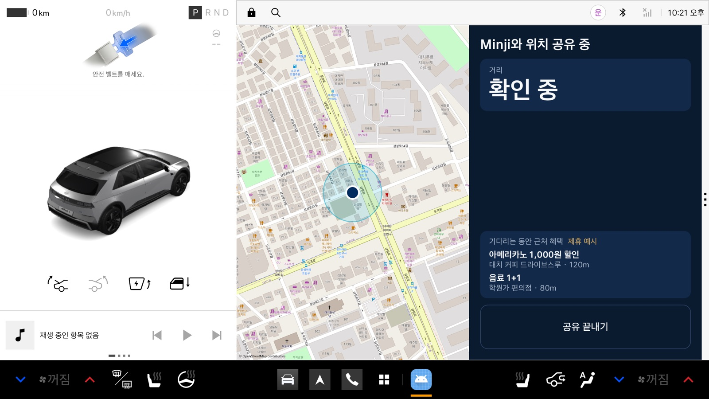
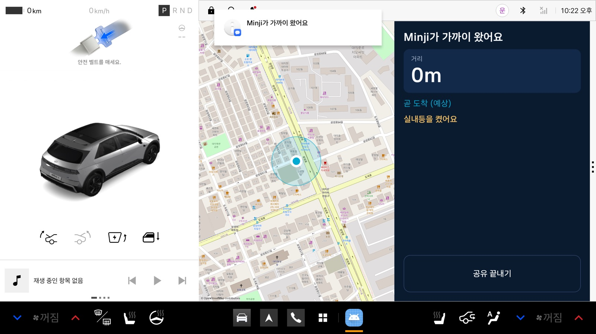
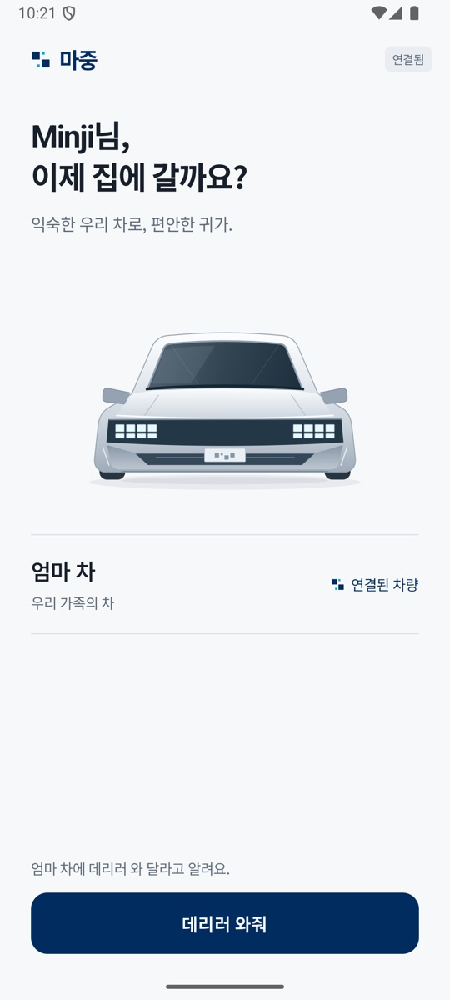
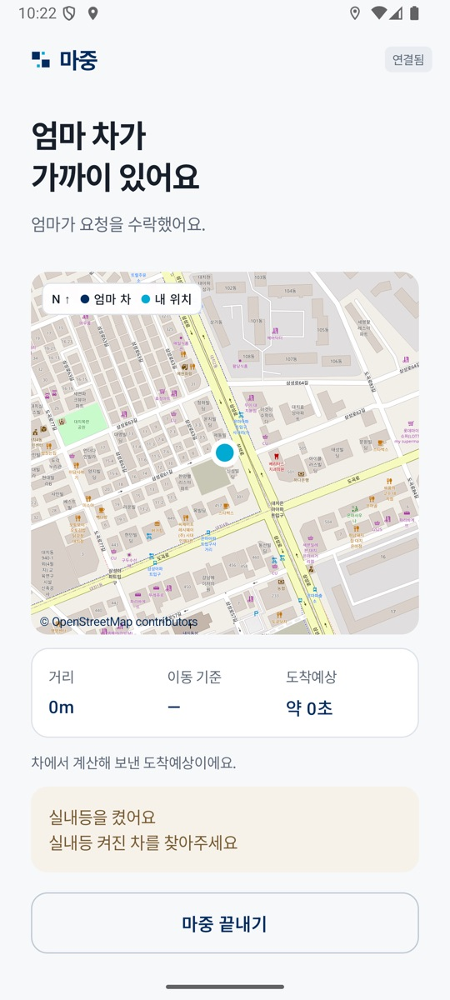

# 마중

**아이가 "데리러 와줘"를 누르면, 차가 알아서 마중 나가는 픽업 앱**

현대자동차그룹 차량용 앱 개발 공모전(Pleos App Market) 출품작입니다. 탑승할 사람이 폰에서 요청하면 차 화면에 알림이 뜨고, 운전자가 수락하면 서로의 위치와 도착 예정 시간을 공유합니다. 아이가 가까이 오면 차가 실내등을 켜서 줄지어 선 차들 사이에서 엄마 차를 찾게 하고, 뒷문이 열렸다 닫히면 탑승으로 판단해 위치공유를 스스로 끝냅니다.

| 차 — 위치 공유 중 | 차 — 아이가 가까이 왔을 때 |
|---|---|
|  |  |

| 폰 — 홈 | 폰 — 근접 |
|---|---|
|  |  |

*Pleos Connect 에뮬레이터와 Android 폰 에뮬레이터에서 `apk/`의 release APK와 배포 서버로 캡처했습니다(11/08). 탑승자 이동은 GPS 좌표 주입입니다.*

## 해결하는 문제

학원 하원 시간, 학원가 앞에는 차가 줄지어 섭니다. 아이는 어느 차가 엄마 차인지 못 찾고, 부모는 운전석에서 "어디야?" 전화를 반복합니다. 메신저 위치공유는 운전 중에 폰을 보게 만들고, 만난 뒤에도 켜진 채로 남습니다.

## 어떻게 동작하나

| 단계 | 탑승자 폰 | 차 | 쓰는 차량 기능 |
|---|---|---|---|
| ① 요청 | "데리러 와줘" | 지금 보던 화면 위에 헤드업 알림 + 음성 안내 | 알림, TextToSpeech |
| ② 수락 | 수락 알림 | 버튼으로 수락·거절(음성 "응"/"아니" 연동) | SpeechToText |
| ③ 이동 | 차 위치·거리·도착 예정 | 지도에 아이 위치, 멀면 길안내 자동 시작 | NaviHelper |
| ④ 차 찾기 | "실내등 켜진 차를 찾아주세요" | 50m 안 + 기어 P면 실내등 ON | Vehicle — Gear, Light |
| ⑤ 탑승 | 자동 종료 | 승객 문 열림→닫힘이면 탑승 확인, 공유·길안내 종료, 실내등 원래대로 | Vehicle — Door, Gear |

- **기다리는 동안 근처 혜택**: 기어 P로 기다리는 동안에만 근처 가게 혜택을 보여주는 수익 모델 데모가 있습니다. 화면의 가게·혜택은 지어낸 예시 데이터이며 "제휴 예시"로 표시합니다.
- **개인정보**: 서버는 승인된 세션에서만 위치를 중계하고 좌표 이력을 저장하지 않습니다. 세션이 끝나면 서버의 세션 정보를 지웁니다.
- **안전**: 차량 제어는 정차 중 실내등 하나뿐입니다. 기어·문은 읽기만 합니다.

## 테스트 환경

| 항목 | 내용 |
|---|---|
| 차 | Pleos Connect Emulator v2.1 (AVD `Pleos_Connect_v2_1`, Android 14 / API 34, arm64). 일반 폰 에뮬레이터에서는 차량 SDK가 동작하지 않습니다 |
| 폰 | Android 8.0(API 26) 이상 폰 또는 에뮬레이터. 검증은 API 36 에뮬레이터에서 했습니다 |
| 서버 | 설정 불필요. release APK에 배포 서버 주소가 들어 있습니다(`/health`로 상태 확인) |
| 차량 신호 | 기어·문은 Pleos Virtual Console로 바꿉니다: `adb forward tcp:8088 tcp:8088` 후 브라우저에서 `http://127.0.0.1:8088/`(BODY 패널이 보이도록 1600px 이상 폭) |
| 위치 | 에뮬레이터는 `adb -s <기기> emu geo fix <경도> <위도>`로 위치를 넣습니다 |
| 권한 | 차 앱 첫 실행 때 위치·마이크·알림, 폰 앱은 "데리러 와줘"를 누를 때 위치·알림 권한을 허용합니다 |
| 네트워크 | 두 기기 모두 인터넷 연결이 필요합니다(지도 타일, 서버 통신) |

차 에뮬레이터 앱은 사용자 10으로 실행됩니다. adb로 직접 열 때는 `adb -s <차> shell am start --user 10 -n com.maejung/.MainActivity`를 씁니다. 소스 빌드·로컬 서버 실행은 [DEVELOPMENT.md](docs/DEVELOPMENT.md)를 참고합니다.

## 직접 실행해 보기

`apk/`의 release APK는 배포 서버(`https://maejung-production.up.railway.app`)에 연결돼 있어 설치만 하면 됩니다.

| 파일 | 설치 대상 |
|---|---|
| [`apk/마중_release.apk`](apk/마중_release.apk) | 차 앱 — Pleos Connect 에뮬레이터 |
| [`apk/마중_phone_release.apk`](apk/마중_phone_release.apk) | 폰 앱 — Android 8.0(API 26) 이상 |

1. 차 앱을 열고 권한을 허용한 뒤 **가족 연결**을 눌러 6자리 코드를 받습니다.
2. 폰 앱에 이름과 코드를 넣고 **연결하기** → **데리러 와줘**.
3. 차에서 **수락**하면 양쪽 지도에 위치가 공유됩니다. 에뮬레이터는 `adb emu geo fix <경도> <위도>`로 위치를 옮깁니다(차 `127.06030 37.49950`, 학원 `127.06280 37.49830`).
4. 폰이 차 50m 안에 들어오면 차 실내등이 켜집니다. Virtual Console에서 기어 P 상태로 뒷문(RR)을 열고 닫으면 탑승으로 판정해 양쪽 공유가 끝납니다.

## 구성

```
maejung/
├── app/        차 앱 — Android Automotive, Pleos Connect SDK, Compose, osmdroid
├── phone/      탑승자 폰 앱 — Android, Compose, osmdroid
├── protocol/   차·폰·서버 공용 메시지 모델 (Kotlin)
├── server/     중계 서버 — Kotlin, Spring Boot, WebSocket (Railway 배포)
├── apk/        제출용 release APK
└── docs/       설계·검증 문서
```

차에는 Google 서비스(GMS)가 없어 FCM 대신 WebSocket으로 요청을 받고, 지도는 OpenStreetMap(osmdroid)을 씁니다. 로그인 대신 차 화면의 6자리 연결 코드와 서버 서명 토큰으로 가족을 연결합니다.

### 사용한 Pleos SDK

| SDK | 용도 |
|---|---|
| Vehicle 2.3.2 — Gear | 기어 P 감지(실내등 조건, 탑승 판정) |
| Vehicle — Light | 실내등 켜기와 원래 상태로 복구 |
| Vehicle — Door | 승객 문 3개의 열림·닫힘(탑승 판정) |
| NaviHelper 3.0.5 | 탑승자 좌표로 길안내 시작·취소, 남은 시간(ETA) |
| TextToSpeech 3.3.1 | 요청·근접·탑승 음성 안내 |
| SpeechToText 3.3.1 | 음성 수락·거절 (연동 구현, 실제 발화 확인 진행 중) |

## 테스트

차 앱 53개, 폰 앱 184개, 공용 모듈 9개, 서버 34개의 단위·통합 테스트가 있습니다. release APK로 새로 설치한 차·폰 에뮬레이터에서 연결 → 요청 → 수락 → 이동 → 근접·실내등 → 뒷문 탑승 → 양쪽 자동 종료를 확인했습니다(11/08).

## 문서

| 문서 | 내용 |
|---|---|
| [DEVELOPMENT.md](docs/DEVELOPMENT.md) | 로컬 실행·빌드, 배포, 단계별 구현·검증 기록 |
| [DESIGN.md](docs/DESIGN.md) | 설계 원칙, 세션 상태, 탑승 판정, Vehicle SDK 매핑 |
| [PROTOCOL.md](docs/PROTOCOL.md) | 차·폰·서버 통신 계약(REST, WebSocket) |
| [CAR_APP.md](docs/CAR_APP.md) · [PHONE_APP.md](docs/PHONE_APP.md) · [SERVER.md](docs/SERVER.md) | 앱·서버별 구조와 검증 |
| [DEMO_SCRIPT.md](docs/DEMO_SCRIPT.md) | 시연 시나리오 "수요일 밤 10시, 대치동 학원가" |
